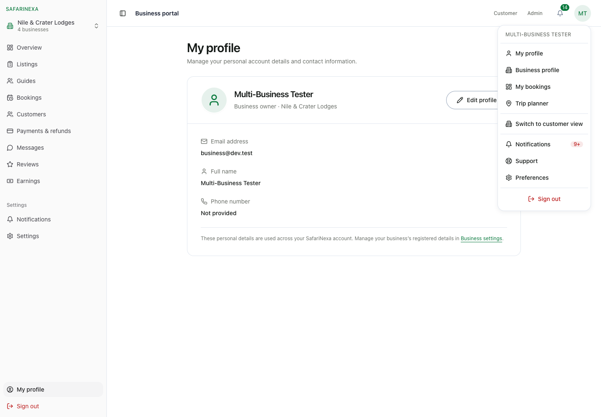
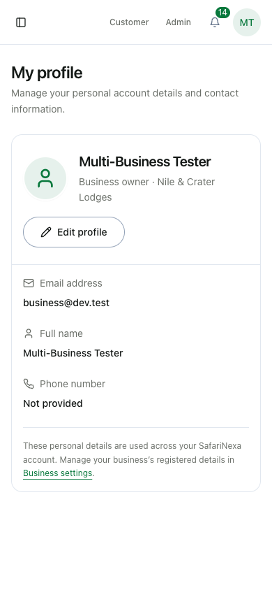

# Business user's personal profile

`/business/profile` is now a personal My profile page, following the admin profile
card/identity/contact pattern. It no longer redirects to registered business
settings. The sidebar footer and account menu both link to it; Business profile
continues to link to `/business/settings`.

The page shows the signed-in account's name, email, phone, avatar/fallback, and role
in the active business. It is read-only by default and offers Edit profile, Save
changes, and Cancel. Email and business role cannot be changed here. Full name is
required; validation errors stay inline in edit mode. Cancel discards the draft.

Owners, managers, and staff may update their own personal name and optional phone.
The save action derives the actor from the session, rechecks active business
membership, and ignores submitted target-user, business, email, and role fields.
Personal details use the existing User identity shared with the customer account;
registered business contacts and the independent AdminUser profile are not changed.

The business session helper exposes only safe, current account fields from its
existing lookup. The portal header therefore reads updated personal details after
a save without relying on stale token display fields or adding another user query.

## Verification

- TypeScript and ESLint passed.
- All 57 suites / 285 tests passed.
- New tests cover personal/business navigation, read-only default, editing by all
  business membership roles, actor-only writes, rejected/revoked membership,
  input validation, optional phone clearing, and unchanged customer-menu routing.
- Chrome checks covered personal and business profile destinations, Edit/Cancel,
  disabled email, a real invalid server-action submission, discarded drafts,
  desktop/mobile layout, and retained business settings.
- Browser verification changed no personal data and raised no browser runtime errors.

