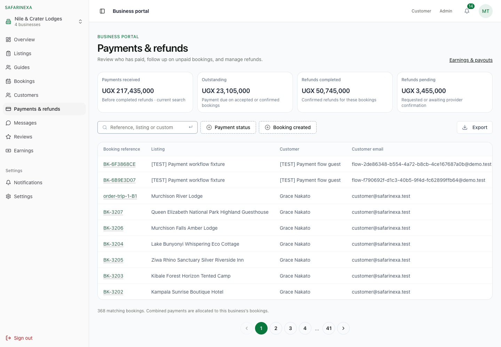
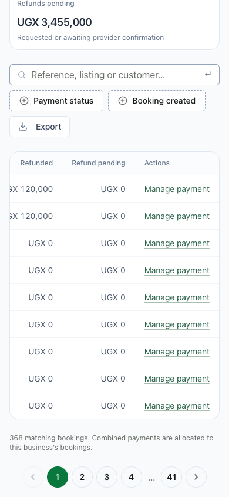

# Compact operational tables

Use `<Table density="compact">` for operational lists that should keep each record
on one visual line. The table uses its natural column width, fills available space,
and scrolls horizontally inside its keyboard-focusable container. Cells do not
wrap and have 10px vertical padding; headers are 40px high. Other tables retain
their existing default density.

Separate independent values into columns instead of stacking paragraphs in a
cell. Retain full values rather than truncating emails, listing titles, references,
or currency amounts. Numeric columns align right and use tabular numerals.

Applied to business payments, customers, bookings, and revenue; admin bookings;
and admin payment/refund tables. Payment columns now separate booking reference,
listing, customer, email, payment status, method, paid, outstanding, completed
refunds, pending refunds, and actions. Related tables split contact details,
service date/time, room/add-on details, and listing references where appropriate.
Existing actions and payment calculations remain intact. CSV exports automatically
use the expanded column structure.

Table button styles exclude `[hidden]` controls, so hidden confirmation submitters
remain hidden and do not add height to refund rows.

## Verification

TypeScript and ESLint passed. All 52 Jest suites / 256 tests passed. Chrome checks
covered seven tables across six pages at 1440×1000 and 390×844. Checks confirmed
matching header/body column counts, no stacked paragraphs or wrapped cells,
maximum data-row heights of 41–53px, horizontal scrolling on mobile, no page-level
horizontal overflow, and no browser runtime errors. No financial actions were
submitted during verification.

