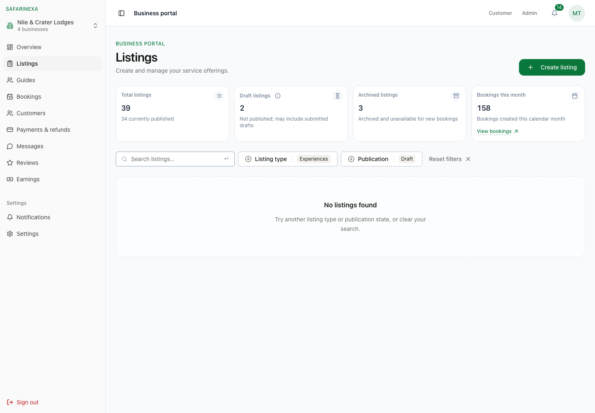
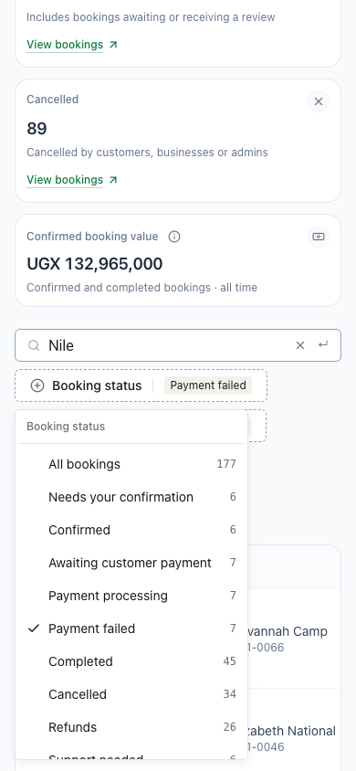
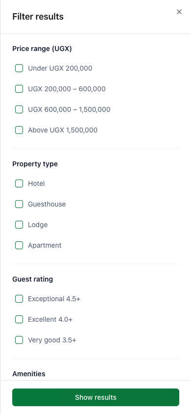

# Filter rebuild — 4 November 2026

Rebuilt the filters using shadcn's [Tasks toolbar](https://ui.shadcn.com/examples/tasks),
[Dropdown Menu](https://ui.shadcn.com/docs/components/radix/dropdown-menu),
[Select](https://ui.shadcn.com/docs/components/radix/select), and
[Checkbox](https://ui.shadcn.com/docs/components/radix/checkbox) patterns.
The previous pill-link status filters and native filter selects have been retired.

## Implementation

`FilterControl` uses an outline trigger, selected-value badge, Radix radio menu,
query-backed option counts where available, and an individual reset action.
`RecordFilter` adapts it to URL-backed server queries; the same control handles
local inbox/document filtering. `RecordSort` uses the shared Radix Select.
Controls share a 36px height, 6px corners, neutral focus/selection surfaces, and
semantic color tokens. Checkboxes use Radix with 4px corners, rather than the
project's larger card radius. Restricted defaults such as Submitted remain visible.

Every page uses relevant facets, rather than a generic copy of another page:

- Booking pages: lifecycle groups and real rolling creation-date windows.
  Admin lifecycle choices now also include payment, refund, and support stages.
- Payments: payment outcomes and date windows. The business page labels its date
  window Booking created because its records are booking-based; admin uses Payment date.
- Listings: independent listing-type and publication-state filters. Availability
  uses a room selector to scope inventory.
- Verification/listing queues: review-stage choices and correct default behavior.
  All verifications explicitly encodes `status=all`, while clearing page defaults
  returns to Submitted. Rejected and suspended remain distinct states.
- Notifications: independent read-status and category facets. Old unread-only URLs
  redirect to the new format.
- Revenue: actual payment-outcome filters, including partial/full refunds, replacing
  the one-option All transactions pill. Financial summaries remain independent of
  the result-list outcome filter. Removed inert date/Daily selectors.
- Reviews: moderation state and, for business reviews, rating/date sorting.
- Users, businesses, support: account-role, verification-state, and case-state choices.
- Inbox/documents: local conversation and document-type filters with the same UI.
- Marketplace: category-specific Radix checkbox groups and shared sorting. Switching
  category now also clears stale tour-duration facets. Mobile uses a fixed header
  and footer with a separately scrolling facet body.

Changing a facet preserves independent search, sort, and other facets and resets
pagination. Pagination retains each newly added facet. Date filtering runs before
pagination/counts. Toolbar Reset filters restores page defaults while keeping
search and sorting. No payment, refund, verification-decision, or inventory-write
actions were exercised during browser verification.

See [tabs-and-filters.md](tabs-and-filters.md) for the complete page/control mapping
and implementation conventions.

## Verification

- TypeScript: passed.
- ESLint: passed without warnings.
- Tailwind stylesheet compilation: passed.
- Jest: 52 suites / 256 tests passed.
- Chrome: exercised 17 distinct pages, including availability. Captured 27 desktop
  and mobile screenshots at 1440×1000 and 390×844. Checked page overflow, combined
  facets, resets, reload and Back behavior, uppercase queue enums, legacy URLs,
  keyboard menu opening/Escape/focus return, visible defaults, and room-filter rendering.
- Marketplace checks confirmed URL-backed checkbox state, square checkbox corners,
  and a visible mobile footer after scrolling to the end of the facet list.
- No browser runtime errors in the main browser pass.
- Existing unrelated workspace edits were preserved.

## Representative screenshots

### Listings: type and publication state

### Booking lifecycle menu on mobile

### Marketplace mobile sheet

