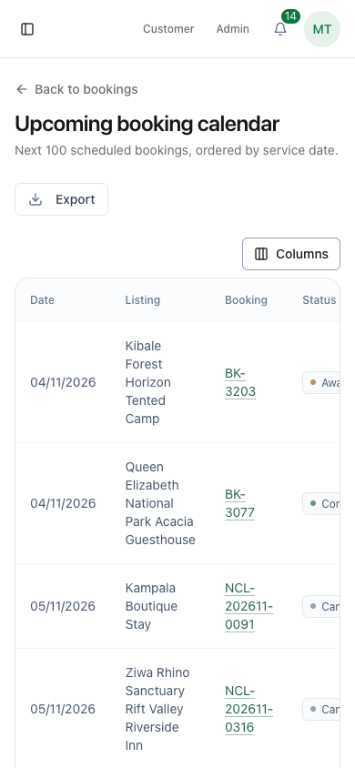
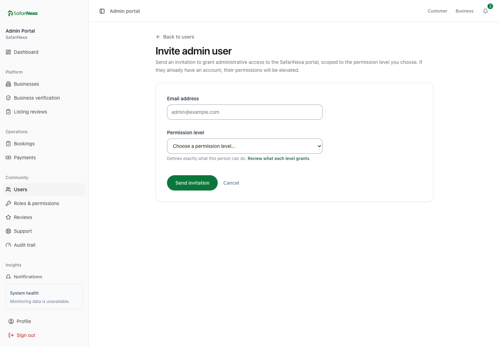

# Application heading review — 4 November 2026

Audited all 105 App Router page files and the layouts/components that supply their
headings. The pasted example was the upcoming booking calendar. Its typography
already used the page token, but back navigation and spacing were separately
assembled; those now belong to the shared header.

## Shared contract

- `PageHeader` owns a functional page's title, description, optional eyebrow,
  back navigation, and optional actions. It gives these elements consistent
  spacing, neutral subtitle styling, wrapping, and responsive action placement.
- `PageTitle` is the single implementation of a page-level h1. Ordinary titles
  use `type-page`: 24px on mobile and 30px from the small breakpoint upward.
- `PageHero` delegates portal headers to `PageHeader`. Marketing heroes retain
  the explicit display variant; image headers retain white text/contrast.
- Rich listing/guide headers and authentication cards can use `PageTitle` within
  their existing structure. Section titles remain lower-level headings.
- Markdown document content demotes its top-level titles so the page's title
  remains the one h1. Receipt status descriptions retain live status semantics.

## Coverage and fixes

Standardized list, detail, creation/edit, booking, account, cart/checkout/payment,
authentication, invitation, onboarding, demo, and error/not-found page headings.
Removed ad hoc title sizes/colors and unified title/subtitle groups. Calendar,
availability, and applicable admin creation/review screens now use the shared
back-navigation treatment. Customer account pages and business inbox headers use
the same header contract. The itinerary editor now has a proper page heading
separate from its editable itinerary-name input.

The business dashboard's View business profile link now opens Business settings,
following the earlier separation of personal and registered-business profiles.

## Verification

- `npm run audit:headings`: 105 pages checked, 2 supplied by parent layouts,
  7 redirect-only routes, no missing/unshared headings. The audit follows rendered
  component imports and rejects standalone h1 implementations outside PageTitle.
- TypeScript and ESLint passed without warnings.
- All 58 Jest suites / 288 tests passed.
- Chrome completed 91 route checks (88 distinct URLs), covering public,
  business, admin, customer, authentication/status, and record-detail screens.
  The run checked one shared h1 per rendered screen, actual font sizes, page
  overflow, and white title text over image/dark headers.
- Calendar and personal-profile headings were also checked at 390×844; desktop
  checks used 1440×1000. No browser runtime errors occurred.
- No booking, payment, profile, invitation, or inventory actions were submitted.

Run `npm run audit:headings` when adding pages. New pages should use the shared
header/title components rather than setting their own h1 sizes or subtitle rules.

