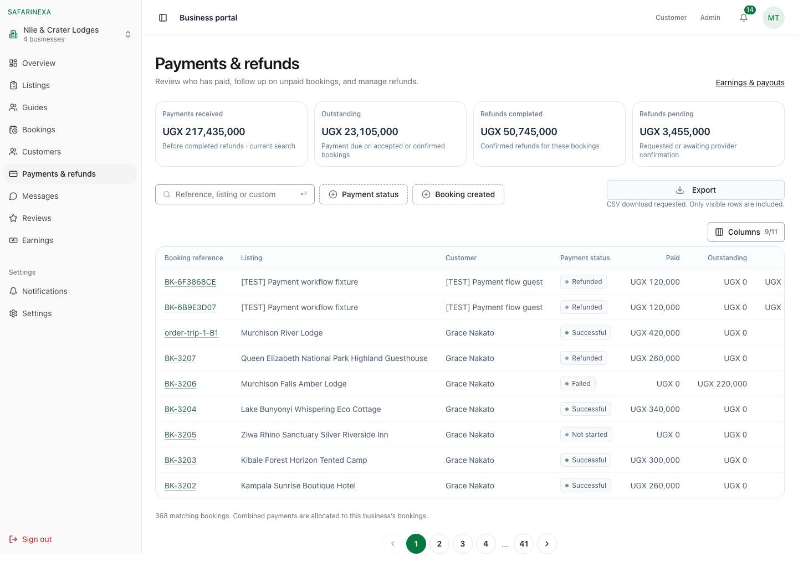
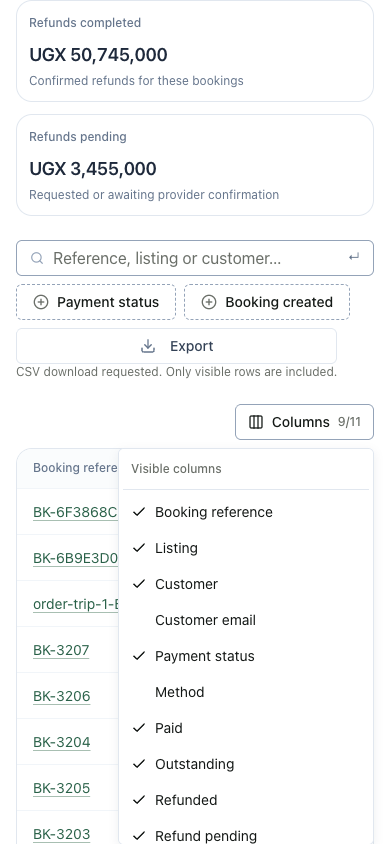

# Table column visibility

Every existing operational table has a Columns menu. All columns are visible until
the user hides one. The menu stays open while making several selections, shows
checked items, and provides Show all columns. At least one column remains visible.

Preferences are stored in this browser's localStorage, separately for each signed-in
user and stable table ID. Only excluded column IDs are stored; no row data is saved.
Choices survive reload, pagination, filtering, and returning to the page. Changes
sync across browser tabs. New columns start visible. Invalid preferences fall back
to all columns, and unavailable storage still allows changes for the current visit.
These browser preferences do not sync across devices.

## Integration

Portal layouts already provide `TablePreferencesProvider` with the server-verified
user ID. Give every table a stable semantic ID and accessible label:

```tsx
<PortalToolbar tableId="business-payments" search={<PortalSearch />} />
<Table tableId="business-payments" aria-label="Booking payments" density="compact" externalTools>
  {/* shared TableHeader, TableRow, TableHead, TableBody and TableCell */}
</Table>
```

Do not use page numbers, search terms, row IDs, or translated display text as the
table ID. Separate tables on one page need separate IDs; admin payments and refunds
therefore have independent preferences.

Header text supplies each column's default ID/label. For dynamic headings or
renaming a heading while retaining its preferences, supply explicit `columnId` and
`columnLabel` props on `TableHead`. Header and body cells share column positions;
spanning empty-state cells adjust to the number of visible columns. Hidden cells
remain in React's tree, preserving form/action state, but are removed from layout,
keyboard navigation, and the accessibility tree. CSV export excludes hidden cells.

## Verification

- TypeScript and ESLint passed without warnings.
- All 54 suites / 270 tests passed, including ten new visibility tests.
- Chrome checked choosers across all 14 current tables, persisted choices after
  reload and filter changes, same-page payment/refund isolation, Show all reset,
  mobile layout, and CSV downloads excluding hidden columns.
- No browser runtime errors in the verification pass.
- Verification used the isolated `.next-verify` server.






Export and Columns now share one icon-only action group in the page toolbar. See
[table-toolbar-review.md](table-toolbar-review.md) for the current integration and
visual verification; the earlier screenshots above predate that alignment update.
