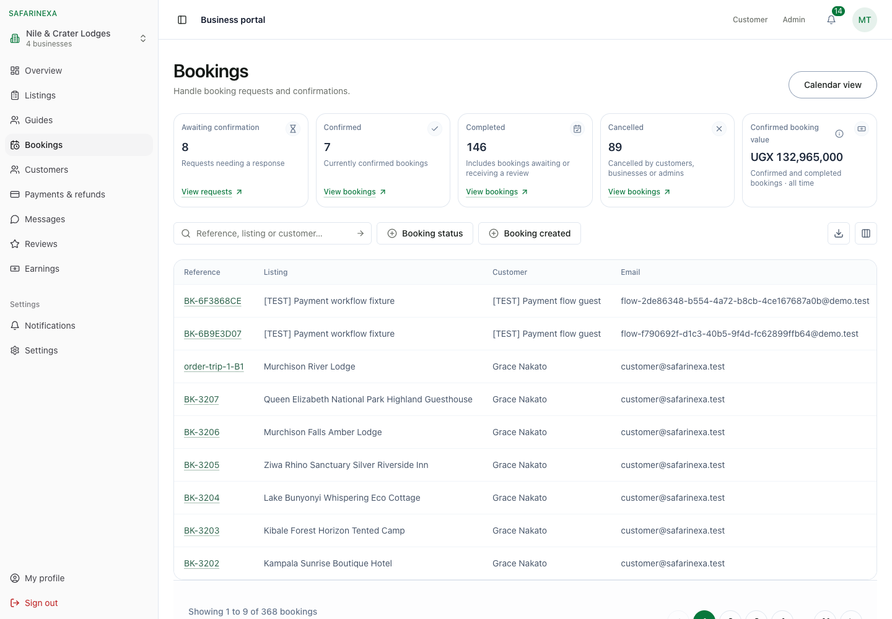
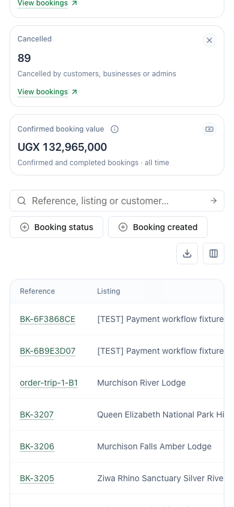

# Unified table controls

Every table now presents Export and Columns as adjacent, accessible icon buttons.
Both controls use 36×36px dimensions, 6px corners, the same neutral border/background,
and matching hover/focus styling. Tooltips and accessible labels identify the
icons. Column visibility and per-user browser persistence remain unchanged.

Search controls use the same height, corner radius, and border. Search has a clear
button and an icon submit action; duplicate native clear icons are suppressed.
Status/date facets use solid borders matching the other controls. Controls can
wrap on small screens, while the Export/Columns pair stays together on one line.

## Shared integration

Pages with existing search/filter toolbars identify their table on both components:

```tsx
<PortalToolbar tableId="business-payments" search={<PortalSearch />} filters={filters} />
<Table tableId="business-payments" aria-label="Booking payments" externalTools>
  {/* shared table primitives */}
</Table>
```

The table's tools render into its toolbar slot through a React portal. The shared
provider owns those slots; no page-specific DOM queries or CSS positioning are
needed. Search/filter controls remain available when there are no matching rows.
Tables without an external toolbar automatically get the same action group above
the table. Do not add a separate Export or Columns row.

CSV exports target their own table, honor hidden columns, and escape formula-like
values. Refund exports on the admin payments page therefore exclude the payments
table. Download announcements are screen-reader-only so they cannot widen the
button or disrupt toolbar alignment.

## Verification

- All 14 tables checked in Chrome at 1440px and 390px viewport widths.
- Export and Columns share the same vertical coordinate and are 36×36px.
- Search and tools match height, radius, and border color; no page-level overflow.
- Saved column choices, Show all, visible-column CSV export, independent same-page
  exports, search submission, clear search, and no-result filtering passed.
- TypeScript and ESLint passed without warnings.
- All 59 suites / 290 tests passed; no browser runtime errors.




